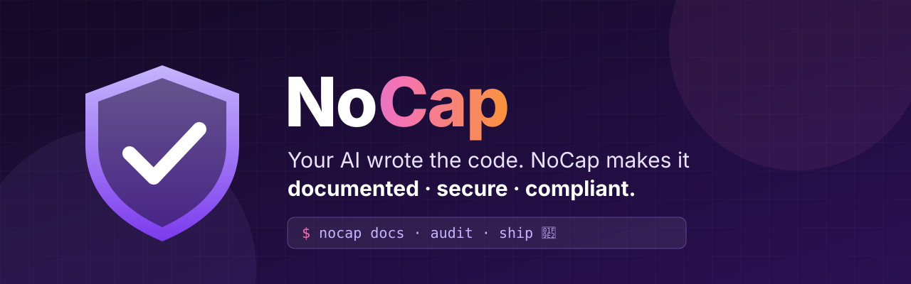
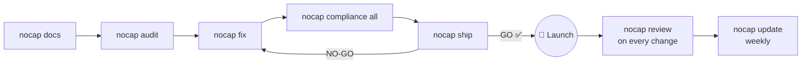

<p align="center">
  
</p>

<h3 align="center">Your AI wrote the code. NoCap tells you the truth about it. 🧢</h3>

<p align="center">
  Docs · Security · Compliance — for anything you build with AI.<br>
  <b>One prompt · Any AI · Any IDE · Any language · Zero dependencies</b>
</p>

<p align="center">
  <a href="LICENSE"></a>
  
  
  
</p>
<p align="center">
  <a href="docs/"></a>
  <a href="CONTRIBUTING.md"></a>
  <a href="TERMS.md"></a>
</p>

<p align="center">
  <a href="https://sanket-manohar.github.io/NoCap/"><b>🌐 Website</b></a> ·
  <a href="#-quick-start">Quick start</a> ·
  <a href="#-all-commands">Commands</a> ·
  <a href="#-use-it-in-your-ai-tool">AI tools</a> ·
  <a href="#-the-scanner">Scanner</a> ·
  <a href="#%EF%B8%8F-cicd--github-action">CI/CD</a> ·
  <a href="#-recipes">Recipes</a> ·
  <a href="#-faq--troubleshooting">FAQ</a> ·
  <a href="#%EF%B8%8F-terms-of-use--disclaimer">Terms</a>
</p>

---

## 🤔 Why NoCap?

You shipped an app in a weekend with Cursor, Claude Code, Copilot, Bolt, Lovable or v0. Main character energy. 🎉
Then reality hits:

> 😶 *"How does this thing actually work?"* There are no docs.<br>
> 🔑 *"Is my API key sitting in the frontend?"* Maybe.<br>
> 🕵️ *"Can user A read user B's data?"* Nobody checked.<br>
> ⚖️ *"Are we GDPR / DPDP / HIPAA / PCI ready?"* 🤷

**NoCap turns any AI assistant into a senior architect, technical writer and security reviewer for your project.**

<table>
<tr>
<td width="25%" align="center">📚<br><b>Docs</b><br><sub>17 standard documents, generated from your real code</sub></td>
<td width="25%" align="center">🔐<br><b>Security</b><br><sub>100+ automated checks plus a full AI audit, each issue with its fix</sub></td>
<td width="25%" align="center">⚖️<br><b>Compliance</b><br><sub>GDPR · DPDP · HIPAA · PCI · SOC 2 · ISO · WCAG · AI Act</sub></td>
<td width="25%" align="center">🏅<br><b>Score</b><br><sub>A+ to F, with a README badge</sub></td>
</tr>
</table>

---

## 🚀 Quick start

**Pick the path that fits you.** All three take under a minute.

| If you… | Do this | Needs |
|---|---|---|
| 🟢 **just want to try it** | [Path 1: paste one prompt](#path-1--paste-one-prompt-zero-install) | Any AI chat |
| 🟣 **code in an AI IDE** (Cursor, Claude Code, Copilot…) | [Path 2: install into your project](#path-2--install-into-your-project-recommended) | Nothing else |
| 🔵 **want every PR checked** | [Path 3: add the GitHub Action](#path-3--check-every-pull-request) | GitHub |

### Path 1 · Paste one prompt (zero install)

1. Open **[MASTER_PROMPT.md](MASTER_PROMPT.md)** and copy the text inside the box.
2. Paste it into **ChatGPT, Claude, Gemini, Copilot Chat, DeepSeek**, or any AI chat.
3. Attach your code (files or a zip) and send.

You get docs, a security audit with fixes, a compliance check and a score. ✨

### Path 2 · Install into your project (recommended)

Open a terminal **inside your project folder** and run the line for your system:

<table>
<tr><th>🍎 macOS · 🐧 Linux · WSL · Git Bash</th></tr>
<tr><td>

```bash
curl -fsSL https://raw.githubusercontent.com/sanket-manohar/nocap/main/install.sh | bash
```
</td></tr>
<tr><th>🪟 Windows (PowerShell)</th></tr>
<tr><td>

```powershell
irm https://raw.githubusercontent.com/sanket-manohar/nocap/main/install.ps1 | iex
```
</td></tr>
<tr><th>📦 Node.js users (any OS)</th></tr>
<tr><td>

```bash
npx github:sanket-manohar/nocap init
```
</td></tr>
<tr><th>📁 No terminal? Manual download</th></tr>
<tr><td>

Download the latest **[Release zip](https://github.com/sanket-manohar/nocap/releases/latest)**, unzip it, and run `install.sh` (Mac/Linux) or `install.ps1` (Windows) with your project folder:
`./install.sh /path/to/my-app` · `.\install.ps1 -Target C:\code\my-app`
</td></tr>
</table>

Then open your AI assistant and type, in plain words:

```text
nocap docs      →  writes all your documentation into docs/
nocap audit     →  finds security problems and shows the exact fix for each
nocap ship      →  GO / NO-GO: am I ready to launch?
```

**That's it.** Nothing to configure. NoCap detects your languages, frameworks and services automatically.

<details>
<summary><b>⚙️ Installer options</b></summary>

| Option (bash / npx) | PowerShell | What it does |
|---|---|---|
| `[folder]` | `-Target <folder>` | Project to install into (default: current folder) |
| `--tools cursor,claude` | `-Tools cursor,claude` | Install only some tools. Choices: `generic, claude, cursor, copilot, windsurf, cline, roo, continue, gemini, junie, aider` |
| `--ci` | `-CI` | Also add the GitHub Actions workflow |
| `--uninstall` | `-Uninstall` | Remove NoCap cleanly (your own content is kept) |

Examples:
```bash
curl -fsSL https://raw.githubusercontent.com/sanket-manohar/nocap/main/install.sh | bash -s -- --tools cursor --ci
npx github:sanket-manohar/nocap init ./my-app --tools claude,copilot
```
</details>

<details>
<summary><b>📂 What gets added to my project?</b></summary>

```text
my-app/
├── .nocap/                     ← the toolkit (prompts, templates, checklists, scanner, TERMS)
│   ├── vp  /  vp.cmd           ← scanner shortcut
├── AGENTS.md                   ← universal AI instructions (block added, your content kept)
├── CLAUDE.md · GEMINI.md       ← Claude Code / Gemini (block added, your content kept)
├── .claude/commands/nocap-*.md ← Claude Code slash commands
├── .cursor/rules/nocap.mdc     ← Cursor
├── .github/copilot-instructions.md + .github/prompts/nocap-*.prompt.md  ← GitHub Copilot
├── .windsurf/rules/nocap.md    ← Windsurf
├── .clinerules/ · .roo/rules/ · .continue/rules/   ← Cline · Roo · Continue
├── .junie/guidelines.md        ← JetBrains Junie
└── .aider.conf.yml             ← Aider (only if you don't already have one)
```
Re-running the installer **updates** NoCap safely. It never duplicates blocks or deletes your text.
</details>

### Path 3 · Check every pull request

Create `.github/workflows/nocap.yml` (or run the installer with `--ci`):

```yaml
name: NoCap
on: [push, pull_request]
permissions:
  contents: read
jobs:
  nocap:
    runs-on: ubuntu-latest
    steps:
      - uses: actions/checkout@v4
      - uses: sanket-manohar/nocap@v1
        with:
          fail-on: high
```

Every PR gets a full report in the job summary, and the build fails if high or critical issues appear.

---

## 🎯 All commands

Type these **in your AI assistant's chat**. They work in any language, in any tool that has NoCap installed.
(In Claude Code and Copilot you can also use the slash versions, e.g. `/nocap-audit`.)

| Command | What happens | Output |
|---|---|---|
| `nocap` | Shows this list and suggests what to do next | in chat |
| `nocap docs` | Reads your whole codebase and writes the **full documentation set** | `docs/` + `README.md` |
| `nocap audit` | **Security audit**: every issue with severity, file:line, CWE/OWASP, the **corrected code**, and how to verify | `docs/SECURITY_AUDIT.md` |
| `nocap fix` | Fixes audit findings **critical first**, adding a test before each fix | code changes + updated audit |
| `nocap review` | Secure code review of your **current changes** (or `nocap review src/api`) | in chat, PR-style |
| `nocap threat-model` | STRIDE (security) + LINDDUN (privacy) threat model with data-flow diagram | `docs/THREAT_MODEL.md` |
| `nocap compliance <x>` | Compliance gap analysis. `<x>` = `gdpr` · `dpdp` · `hipaa` · `pci` · `soc2` · `iso27001` · `ccpa` · `wcag` · `ai-act` · `all` | `docs/COMPLIANCE.md` |
| `nocap architecture` | C4 diagrams + design-quality review | `docs/ARCHITECTURE.md`, `docs/DESIGN.md` |
| `nocap explain` | Plain-English guide to your own codebase | `docs/ONBOARDING.md` |
| `nocap update` | Updates **only** the docs affected by recent code changes | updated `docs/` |
| `nocap score` | Calculates your NoCap score + README badge | score + `docs/nocap-badge.svg` |
| `nocap ship` | 13-gate **production-readiness** check | ✅ GO / ❌ NO-GO with blockers |

### 🛡️ Bonus: always-on guard rules
Even when you don't type a command, NoCap's rules make your AI **write secure code by default**: no hard-coded secrets,
server-side auth on every route, parameterised queries, validated input, rate limits, safe LLM usage, and more.
[See all guard rules →](prompts/00-guard-rules.md)

### 🔁 The recommended flow



---

## 🧠 Use it in your AI tool

Click your tool for exact steps.

<details>
<summary><b>🟠 Claude Code</b></summary>

1. Install NoCap (Path 2). It adds a block to `CLAUDE.md` and 11 slash commands.
2. Start Claude Code in your project: `claude`
3. Type `/nocap-` and pick a command, e.g. `/nocap-audit`, or just say **"nocap audit"**.
4. Pass arguments after the command: `/nocap-compliance dpdp`, `/nocap-review src/payments`.
</details>

<details>
<summary><b>⚫ Cursor</b></summary>

1. Install NoCap. The rule `.cursor/rules/nocap.mdc` is **always on**.
2. Open the Chat/Agent panel (`Ctrl/Cmd + L` or `Ctrl/Cmd + I`) in **Agent** mode.
3. Type **`nocap docs`**, **`nocap audit`** and so on.
4. Check that the rule is loaded under *Cursor Settings → Rules*.
</details>

<details>
<summary><b>🔵 GitHub Copilot (VS Code · JetBrains · Visual Studio)</b></summary>

1. Install NoCap. It adds `.github/copilot-instructions.md` and prompt files in `.github/prompts/`.
2. Open Copilot Chat and switch to **Agent** mode.
3. Type **`/nocap-audit`** (prompt files appear as slash commands) or just **"nocap audit"**.
4. If slash prompts don't appear, enable prompt files in VS Code settings (`chat.promptFiles`).
</details>

<details>
<summary><b>🌊 Windsurf</b></summary>

1. Install NoCap. It adds `.windsurf/rules/nocap.md` (always on).
2. Open **Cascade** and type **`nocap audit`**.
</details>

<details>
<summary><b>🤖 Cline · Roo Code · Continue · Kilo</b></summary>

Install NoCap. It adds `.clinerules/`, `.roo/rules/` and `.continue/rules/`. Open the extension's chat in **Act/Agent** mode and type **`nocap docs`**.
</details>

<details>
<summary><b>✨ Gemini CLI / Gemini Code Assist</b></summary>

1. Install NoCap. It adds a block to `GEMINI.md`.
2. Run `gemini` in your project and type **`nocap audit`**.
</details>

<details>
<summary><b>🧩 OpenAI Codex · Zed · Jules · Amp · Factory · any AGENTS.md tool</b></summary>

These tools read `AGENTS.md`, which NoCap installs. Open the agent in your project and type **`nocap ship`**.
</details>

<details>
<summary><b>🟪 JetBrains Junie</b></summary>

Install NoCap. It adds `.junie/guidelines.md`. Ask Junie: **`nocap explain`**.
</details>

<details>
<summary><b>🛠️ Aider</b></summary>

Install NoCap. It adds `.aider.conf.yml` with `read: .nocap/AGENTS.md`. Run `aider` and type **`nocap review`**.
</details>

<details>
<summary><b>💬 ChatGPT · Claude.ai · Gemini web · any chat app</b></summary>

No install. Paste **[MASTER_PROMPT.md](MASTER_PROMPT.md)** and attach your code. For big projects the AI does one phase per reply. Type **"continue"** for the next.
</details>

<details>
<summary><b>❓ My tool isn't listed</b></summary>

Tell your AI: **"Read `.nocap/AGENTS.md` and follow it. Then run: nocap audit."** It works anywhere an AI can read files.
</details>

---

## 🔍 The scanner

A **single Python file**, **zero dependencies**, runs **100% offline**. Your code never leaves your machine.

```bash
.nocap/vp                          # Mac/Linux, after installing
.nocap\vp                          # Windows, after installing
npx github:sanket-manohar/nocap scan     # via Node
python3 scanner/nocap.py .         # straight from this repo
```

<details open>
<summary><b>👀 What it looks like</b></summary>

```text
  ███╗   ██╗ ██████╗  ██████╗ █████╗ ██████╗
  ████╗  ██║██╔═══██╗██╔════╝██╔══██╗██╔══██╗
  ██╔██╗ ██║██║   ██║██║     ███████║██████╔╝
  ██║╚██╗██║██║   ██║██║     ██╔══██║██╔═══╝
  ██║ ╚████║╚██████╔╝╚██████╗██║  ██║██║
  ╚═╝  ╚═══╝ ╚═════╝  ╚═════╝╚═╝  ╚═╝╚═╝       v1.0.0

  Stack: JavaScript/TypeScript, Node.js, Next.js, Supabase, OpenAI SDK

  CRITICAL SEC013   Secret exposed to the browser via public env prefix
           src/lib/ai.ts:4
  CRITICAL BAAS002  Row Level Security disabled (Postgres/Supabase)
           supabase/migrations/001_init.sql:12
  HIGH     AI001    LLM SDK used directly in the browser (API key exposed)
           src/components/Chat.tsx:9

  Score: F 34/100  (security 22, docs 47)  cooked 💀 — fix the criticals first
```
</details>

### All scanner options

| Option | Default | What it does |
|---|---|---|
| `[path]` | `.` | Folder to scan |
| `--out FILE` | `NOCAP_REPORT.md` | Markdown report (use `-` to skip) |
| `--json FILE` | — | Machine-readable results |
| `--badge FILE` | — | SVG score badge for your README |
| `--fail-on LEVEL` | `none` | Exit with an error at/above `critical`·`high`·`medium`·`low` (for CI) |
| `--min-severity LEVEL` | `info` | Hide lower-severity findings |
| `--exclude GLOB` | — | Skip paths (repeatable): `--exclude "legacy/*"` |
| `--list-rules` | — | Show all rules |
| `--no-color` · `--quiet` | — | Output control |
| `--version` · `--help` | — | Info |

**Exit codes:** `0` OK · `1` findings at or above `--fail-on` · `2` bad input / Python missing

```bash
.nocap/vp . --badge docs/nocap-badge.svg --json results.json --fail-on high
```

### What it checks (100+ checks, 20+ languages & formats)

| Category | Examples |
|---|---|
| 🔑 **Secrets** | AWS, GitHub, Stripe, OpenAI, Anthropic, Google, Slack, SendGrid keys · private keys · DB URLs · passwords · secrets behind `NEXT_PUBLIC_`/`VITE_` |
| 💉 **Injection** | SQL/NoSQL (JS, Python, Java, C#, Go, PHP, Ruby) · shell commands · `eval` · file inclusion |
| 🌐 **Web** | XSS sinks · CORS `*` · CSRF disabled · SSRF · open redirects · path traversal · mass assignment · tokens in localStorage |
| 🔐 **Crypto & auth** | MD5/SHA-1 · ECB/DES · insecure randomness · JWT `none` / unverified · TLS verification disabled |
| 🤖 **AI / LLM** | SDK keys in the browser · LLM output executed · prompt injection risks · over-powered agent tools |
| 🗄️ **Supabase / Firebase** | RLS disabled or missing · `using (true)` policies · `service_role` in client · `if true` rules |
| 📱 **Mobile** | Cleartext traffic · debuggable · allowBackup · ATS disabled · insecure token storage · WebView bridges |
| ☁️ **Cloud / DevOps** | Docker root/`latest`/secrets · privileged K8s · public S3/DB · `0.0.0.0/0` · GitHub Actions injection |
| 📦 **Supply chain & hygiene** | Missing lockfile · unpinned deps · install scripts · no `.gitignore` · `.env` committed · no tests/CI |
| 📚 **Docs coverage** | Which of the 17 standard docs exist |

**Languages:** JS/TS · Python · Java/Kotlin · Go · PHP · Ruby · C#/.NET · Rust · C/C++ · Swift · Dart · SQL · Shell · Solidity · HTML templates · YAML · JSON · Terraform · XML/plist · Dockerfile · `.env`

### Ignore a false positive
```js
el.innerHTML = clean; // nocap-ignore XSS001 — sanitized with DOMPurify above
```
Add `nocap-ignore-file` in the first 5 lines to skip a whole file, or use `--exclude`.

### 🏅 Score & verdicts

**Score = 70% security + 30% documentation.** Any critical issue caps the score at 49. Any high issue caps it at 79.

| Grade | Score | Verdict |
|:--:|:--:|---|
| **A+** | 95–100 | it's giving secure ✨ |
| **A** | 85–94 | solid, no cap 💪 |
| **B** | 70–84 | mid but fixable 🛠️ |
| **C** | 55–69 | kinda sus 👀 |
| **D** | 40–54 | red flags everywhere 🚩 |
| **F** | 0–39 | cooked 💀 |

Show it off: ``

> 💡 The scanner catches **patterns**. `nocap audit` catches **logic**: broken authorisation, business-logic abuse, insecure design. Use both.

---

## ⚙️ CI/CD & GitHub Action

| Input | Default | Description |
|---|---|---|
| `path` | `.` | Folder to scan |
| `fail-on` | `high` | `critical` · `high` · `medium` · `low` · `none` |
| `exclude` | — | Comma-separated globs, e.g. `tests/*,legacy/*` |
| `upload-report` | `true` | Upload report, JSON and badge as a build artifact |

| Output | Example |
|---|---|
| `score` | `92` |
| `grade` | `A` |

<details>
<summary><b>GitLab CI · Bitbucket · Azure · Jenkins · any CI</b></summary>

Any runner with Python 3.8+ works:
```bash
git clone --depth 1 https://github.com/sanket-manohar/nocap /tmp/nocap
python3 /tmp/nocap/scanner/nocap.py . --fail-on high --json nocap.json
```
</details>

---

## 📚 What you get

<details open>
<summary><b>17 standard documents from <code>nocap docs</code></b></summary>

| Document | What's inside | Standard |
|---|---|---|
| `README.md` | Features, quick start, env vars, scripts, structure | — |
| `docs/ARCHITECTURE.md` | Context/container/component diagrams, runtime flows, deployment | C4 + arc42 |
| `docs/DESIGN.md` | Patterns, state, errors, caching, UI system, accessibility | ISO 25010 |
| `docs/MODULES.md` | Every module: purpose, interface, dependencies, risks | — |
| `docs/API.md` | Every endpoint: auth, roles, schemas, errors, limits | OpenAPI 3.1 style |
| `docs/DATA_MODEL.md` | ER diagram, PII classification, retention, access policies | — |
| `docs/SECURITY.md` | Auth model, permission matrix, secrets, crypto, headers | OWASP ASVS 5.0 |
| `docs/THREAT_MODEL.md` | Data-flow diagram, threats, mitigations | STRIDE + LINDDUN |
| `docs/PRIVACY.md` | Data inventory, legal basis, user rights, sub-processors | GDPR / DPDP |
| `docs/COMPLIANCE.md` | Applicable frameworks + gap tables + roadmap | — |
| `docs/TESTING.md` | Strategy, coverage, missing security tests | — |
| `docs/DEPLOYMENT.md` | Environments, pipeline, infra, rollback, backups | — |
| `docs/RUNBOOK.md` | Incidents, leaked-secret steps, breach notification | NIST SP 800-61 |
| `docs/ONBOARDING.md` | Day-1 guide for new developers | — |
| `docs/adr/` | Architecture decision records | Nygard ADR |
| `CHANGELOG.md` | Version history | Keep a Changelog |
| `CONTRIBUTING.md` | Workflow + PR security checklist | Conventional Commits |
</details>

<details>
<summary><b>33 checklists, each item with its standard fix</b></summary>

| Area | Coverage |
|---|---|
| 🔐 Security | OWASP Top 10:2025 · API Top 10:2023 · LLM Top 10:2025 · ASVS 5.0 · 🔥 [Vibe-Coding Top 25](checklists/security/VIBE_CODING_TOP25.md) |
| 💻 Languages | JS/TS · Python · Java/Kotlin · Go · PHP · Ruby · C#/.NET · Rust · C/C++ · Swift · Dart/Flutter · SQL & databases · Solidity |
| 🧱 Platforms | Web frontend · API/backend · Mobile (MASVS) · Cloud/containers/IaC/CI · Supabase/Firebase |
| ⚖️ Compliance | GDPR · India DPDP 2023 + Rules 2025 · CCPA/CPRA · HIPAA · PCI DSS 4.0.1 · SOC 2 · ISO 27001:2022 · WCAG 2.2 · EU AI Act |
| 🏗️ Quality | Architecture · code · reliability · performance · operability · testability |

[Browse all checklists →](checklists/)
</details>

---

## 🍳 Recipes

<details>
<summary><b>"I vibe-coded a Next.js + Supabase app. Is it safe?"</b></summary>

```text
1. Install NoCap (Path 2)
2. .nocap/vp                       → quick scan: look for SEC013, BAAS00x, AI001
3. nocap audit                     → full audit with fixes
4. nocap fix                       → let your AI fix criticals first
5. Rotate any key that was ever in your code (NoCap tells you which)
```
</details>

<details>
<summary><b>"We launch next week."</b></summary>

```text
nocap audit  →  nocap fix  →  nocap compliance all  →  nocap ship
```
Keep going until `nocap ship` says **GO ✅**.
</details>

<details>
<summary><b>"We serve users in India / Europe. What do we need?"</b></summary>

```text
nocap compliance dpdp      # India: DPDP Act 2023 + Rules 2025
nocap compliance gdpr      # EU / UK
nocap docs                 # creates PRIVACY.md with your data inventory
```
</details>

<details>
<summary><b>"A new developer joins tomorrow."</b></summary>

```text
nocap explain              # → docs/ONBOARDING.md
nocap architecture         # → diagrams they can actually follow
```
</details>

<details>
<summary><b>"Keep everything up to date as we build."</b></summary>

- Add the GitHub Action (Path 3) so every PR is scanned.
- Run `nocap review` before each commit.
- Run `nocap update` weekly to keep docs in sync.
</details>

---

## 🔄 Update · Uninstall

| Task | Command |
|---|---|
| **Update** NoCap in a project | Re-run the install command. It updates in place, safely |
| **Uninstall** (Mac/Linux) | `curl -fsSL https://raw.githubusercontent.com/sanket-manohar/nocap/main/install.sh \| bash -s -- --uninstall` |
| **Uninstall** (Windows) | `.\install.ps1 -Uninstall` from a downloaded copy |

Uninstalling removes only NoCap's files and marked blocks. Your own content stays.

---

## ❓ FAQ & troubleshooting

<details>
<summary><b>Does my code get uploaded anywhere?</b></summary>
No. The scanner is fully offline with no telemetry. The AI commands run inside <i>your</i> AI tool, under that tool's own privacy terms.
</details>

<details>
<summary><b>Do I need Python?</b></summary>
Only for the scanner (Python 3.8+, preinstalled on macOS and most Linux; Windows: <a href="https://www.python.org/downloads/">python.org</a>). All AI commands work without it. <code>nocap score</code> can even compute the score without Python.
</details>

<details>
<summary><b>My AI ignores "nocap audit".</b></summary>
Make sure you're in <b>Agent</b> mode and the project folder is open. Then say: <i>"Read .nocap/AGENTS.md and follow it. Run nocap audit."</i>
</details>

<details>
<summary><b>Windows says scripts are disabled.</b></summary>
For a downloaded <code>install.ps1</code>, run once in that window: <code>Set-ExecutionPolicy -Scope Process Bypass</code>, then run the script again.
</details>

<details>
<summary><b>My project is huge and the AI runs out of space.</b></summary>
Run commands one at a time and scope them: <code>nocap review src/api</code>, <code>nocap docs</code> for one module, then <code>nocap update</code>.
</details>

<details>
<summary><b>Which languages and frameworks are supported?</b></summary>
All of them for the AI commands. The scanner has dedicated rules for 20+ languages and formats, plus generic checks.
</details>

<details>
<summary><b>Does this replace a pentest or a compliance audit?</b></summary>
<b>No.</b> NoCap is a development aid. Get a professional review before handling payments, health data or children's data. See the <a href="TERMS.md">Terms</a>.
</details>

---

## 🗂️ Repository structure

```text
nocap/
├── MASTER_PROMPT.md        ← paste into any AI (no install)
├── AGENTS.md               ← the brain: commands, guard rules, standards
├── prompts/                ← 12 step-by-step workflows
├── templates/              ← 18 documentation templates
├── checklists/             ← 33 standards-based checklists
├── scanner/nocap.py        ← zero-dependency scanner
├── adapters/               ← generated rules for 12+ AI tools
├── install.sh · install.ps1 · bin/nocap.js · action.yml
├── docs/                   ← NoCap documented with NoCap (scores A+ on itself)
├── examples/               ← sample report from a deliberately vulnerable app
├── TERMS.md · LICENSE · SECURITY.md · CONTRIBUTING.md
```

---

## 🤝 Contributing

New scanner rules, checklists, AI-tool adapters and translations are welcome. See **[CONTRIBUTING.md](CONTRIBUTING.md)**.

If NoCap saved you from a leaked key or an awkward launch, **⭐ star the repo** and share
**[The 25 Ways Vibe-Coded Apps Get Hacked](checklists/security/VIBE_CODING_TOP25.md)** with someone who ships fast.

---

## ⚖️ Terms of Use & Disclaimer

> [!IMPORTANT]
> **NoCap is a free development aid, not a guarantee.**
> - It **can miss issues**, and so can the AI tools that use it. A high score, clean report or "GO" **does not** mean your software is secure or compliant.
> - **Final checks are your responsibility.** Review and test every finding, fix and document before you rely on it or deploy.
> - It is **not legal, security or compliance advice**. Consult qualified professionals where needed.
> - Provided **"as is", without warranty of any kind**. The author and contributors **accept no liability** for any loss, breach, damage, fine or claim arising from its use.
> - Use it only on code and systems **you own or are authorised to test**.
>
> By using NoCap you agree to the full **[Terms of Use](TERMS.md)** and the **[MIT License](LICENSE)**.

---

<p align="center">
  Made with 💜 by <b>Sanket Santosh Vidya Manohar</b><br>
  <sub>MIT License · OWASP® is a trademark of the OWASP Foundation. NoCap is independent and not affiliated with OWASP or any AI vendor.</sub>
</p>
