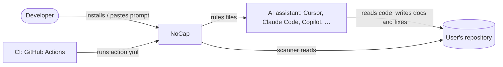
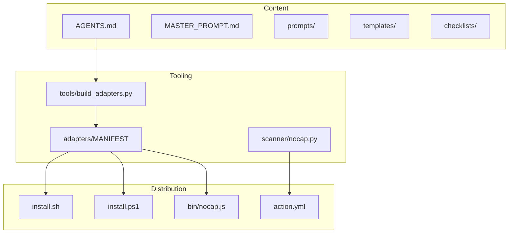
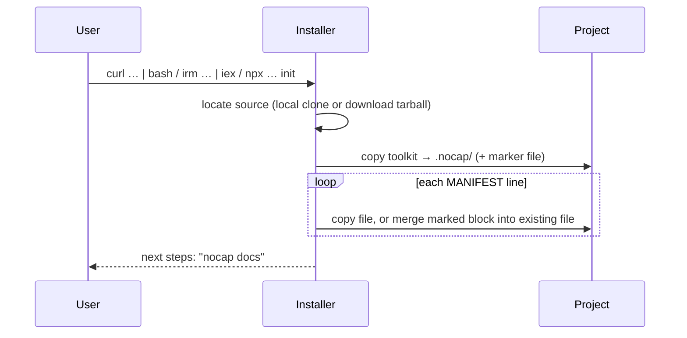

# Architecture — NoCap

> **Audience:** Contributors and reviewers
> **TL;DR:** NoCap is a content toolkit (prompts, templates, checklists) plus a zero-dependency scanner, distributed by four thin installers that all read one manifest.
> **Last verified:** 2026-11-27 · v1.0.0

## 1. Goals & quality attributes
| Priority | Goal | Target |
|---|---|---|
| 1 | Universality | Works with any AI tool, IDE, OS and language. No vendor lock-in |
| 2 | Zero friction | One command or one paste. No dependencies beyond Python (scanner only) |
| 3 | Trustworthiness | Offline, no telemetry, safe install/uninstall, standards-cited content |
| 4 | Maintainability | Single source of truth for agent rules (`AGENTS.md` → generated adapters) |

## 2. Context (C4 L1)

## 3. Containers (C4 L2)

## 4. Runtime: install

## 5. Runtime: scan
`walk()` skips vendored dirs and the toolkit (`.nocap-toolkit` marker). Each file is classified by extension,
then per-line regex rules run (with optional filters and file-name scopes), followed by project-level checks
(gitignore, lockfiles, tests, CI, RLS coverage). `score()` applies capped severity weights. Report writers emit
Markdown, JSON and an SVG badge.

## 6. Cross-cutting concepts
| Concern | Approach |
|---|---|
| Safety of installs | Marked blocks (`<!-- nocap:start/end -->`), idempotent re-install, clean uninstall |
| Secret handling | Findings redact matched secrets; test fixtures assembled at runtime |
| False positives | Inline `nocap-ignore [RULE]`, file-level `nocap-ignore-file`, `--exclude` |
| Consistency | CI fails if generated adapters differ from `AGENTS.md` |

## 7. Risks & debt
| Risk | Mitigation |
|---|---|
| Regex rules miss logic flaws | AI workflows cover logic. Docs say clearly that this is a first line of defence |
| AI tools change rule-file formats | Adapters generated in one place, so a format change means editing one function |
| Standards evolve (OWASP, DPDP dates) | Checklists cite sources and versions. Community updates |
