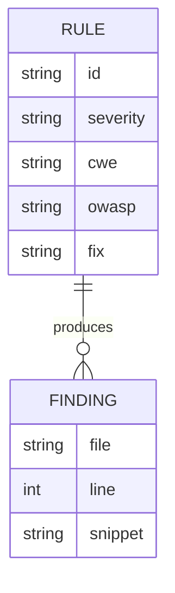

# Data Model — NoCap

> **Audience:** Contributors, privacy reviewers
> **TL;DR:** NoCap stores no data. It reads files locally and writes reports to the scanned folder.
> **Last verified:** 2026-11-27 · v1.0.0

## Data handled
| Data | Source | Stored | PII? |
|---|---|---|---|
| Source file contents | User's repo (read-only) | In memory only | Possibly. Never transmitted |
| Findings (snippets ≤ 180 chars, secrets redacted) | Scanner | `NOCAP_REPORT.md`, optional JSON | Possibly code excerpts |

Recommendation: keep `.nocap-results.json` git-ignored (the installer does this).
