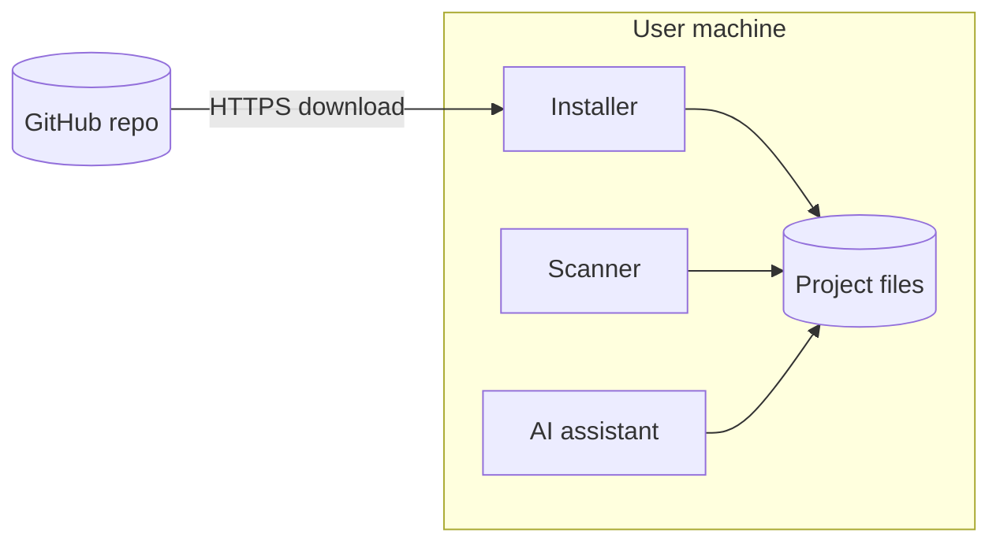

# Threat Model — NoCap

> **Audience:** Security reviewers
> **TL;DR:** Main threats are a tampered installer/repo and prompt content that misleads AI assistants.
> **Last verified:** 2026-11-27 · v1.0.0

| ID | STRIDE | Threat | Mitigation |
|---|---|---|---|
| T1 | Tampering | Compromised repo/maintainer pushes malicious installer | Branch protection, signed tags/releases, review of installer changes, pin to tag `@v1` |
| T2 | Tampering | Malicious PR adds prompt text instructing AIs to exfiltrate data | Prompts/adapters reviewed as code. Guard rules forbid secret exposure |
| T3 | Info disclosure | Report leaks secrets | Redaction + results JSON git-ignored |
| T4 | DoS | Huge or binary files slow the scan | 1.5 MB cap, binary sniffing, skip dirs, line-length cap |
| T5 | Elevation | Action script injection via inputs | `env:` indirection, composite action with read-only token |
