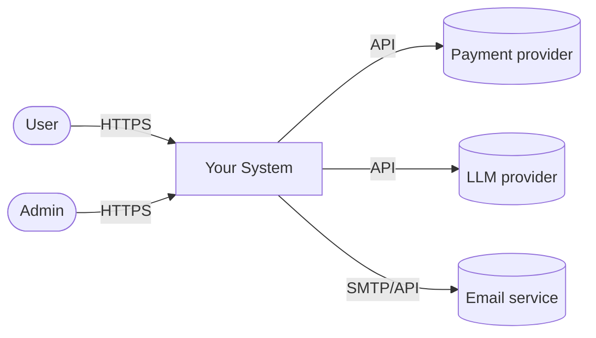
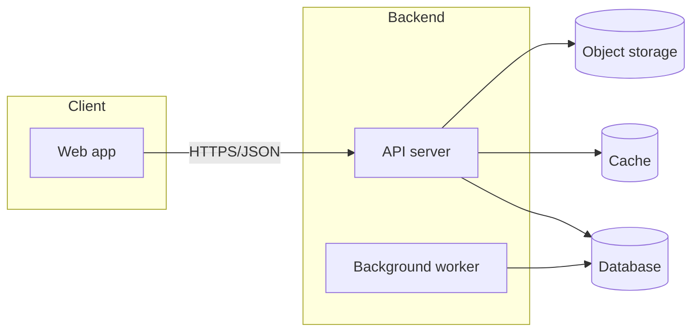
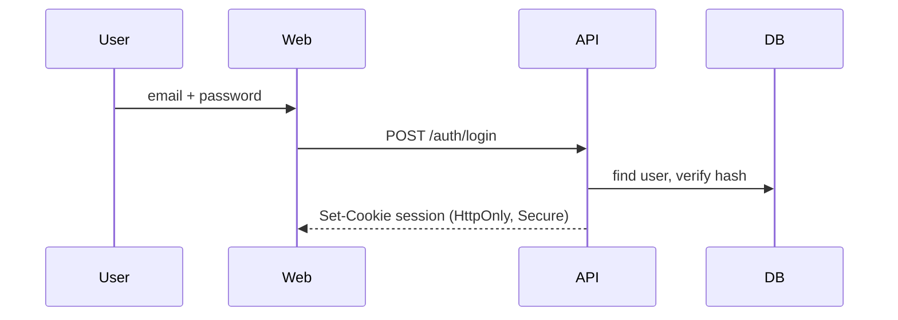

# Architecture

> **Audience:** Engineers, architects, security reviewers
> **TL;DR:** _3 lines max — what this document tells the reader._
> **Last verified:** YYYY-MM-DD · commit `abc1234` · Owner: @name

Structure: arc42 · Diagrams: C4 in Mermaid

## 1. Goals & quality attributes
| Priority | Quality goal (ISO 25010) | Scenario / measurable target |
|---|---|---|
| 1 | Security | e.g. No user can read another user's data (verified by tests) |
| 2 | Performance | e.g. p95 API latency < 300 ms at 100 RPS |
| 3 | Maintainability | |

## 2. Constraints
Technical, organisational, regulatory (e.g. data must stay in India/EU).

## 3. System context (C4 L1)

## 4. Containers (C4 L2)

| Container | Technology | Responsibility | Data it owns |
|---|---|---|---|

## 5. Building blocks / components (C4 L3)
See [MODULES.md](MODULES.md) for detail.

## 6. Runtime view
### 6.1 Sign-in

### 6.2 Core user flow
### 6.3 Payment / AI flow (if any)

## 7. Deployment view
Environments, regions, CDN, serverless/containers, managed services, network boundaries.

## 8. Cross-cutting concepts
| Concern | Approach | Where in code |
|---|---|---|
| Authentication | | |
| Authorisation | | |
| Validation | | |
| Error handling | | |
| Logging / tracing | | |
| Configuration | | |
| Caching | | |
| i18n | | |

## 9. Architecture decisions
See [adr/](adr/).

## 10. Risks & technical debt
| Risk / debt | Impact | Mitigation | Owner |
|---|---|---|---|

## 11. Glossary
