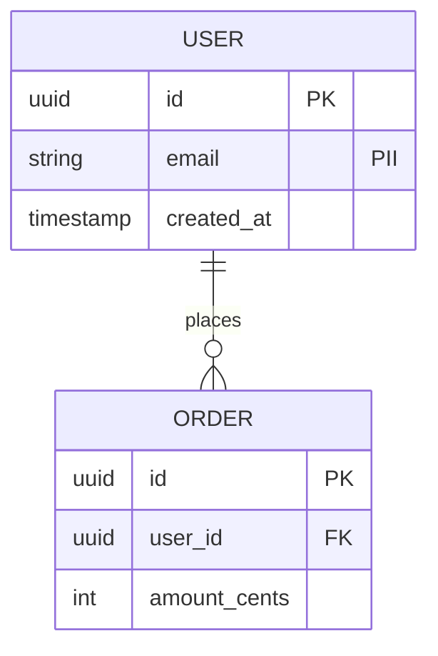

# Data Model

> **Audience:** Engineers, DPO/privacy, auditors
> **TL;DR:** _3 lines max — what this document tells the reader._
> **Last verified:** YYYY-MM-DD · commit `abc1234` · Owner: @name

## Tables / collections
### `users`
| Field | Type | Null | PII class | Encrypted | Notes |
|---|---|---|---|---|---|
| email | text | no | Personal | at rest (disk) | unique index |

- **Access policy:** (RLS / security rules / repository checks): `auth.uid() = id`
- **Retention:** deleted 30 days after account deletion
- **Indexes:** …

## Data classification
| Class | Examples | Handling |
|---|---|---|
| Public | product names | none |
| Internal | analytics aggregates | auth required |
| Confidential / Personal | email, phone, address | encrypt, mask in logs, export/delete supported |
| Restricted / Sensitive | passwords (hashed), payment, health, government IDs, children's data | minimise, encrypt field-level, strict access, audit |

## Migrations
Tool, location, rollback approach.
