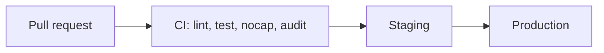

# Deployment

> **Audience:** DevOps, engineers
> **TL;DR:** _3 lines max — what this document tells the reader._
> **Last verified:** YYYY-MM-DD · commit `abc1234` · Owner: @name

## Environments
| Env | URL | Branch | Data | Who can deploy |
|---|---|---|---|---|

## Pipeline

## Infrastructure
Provider, region, services, IaC location, network diagram.

## Configuration & secrets
Where env vars are set per environment (never in the repo).

## Release process
Versioning (SemVer), changelog, feature flags, DB migrations order.

## Rollback
Exact steps and time to roll back app and DB.

## Backups
What, frequency, retention, encryption, **last restore test date**.
