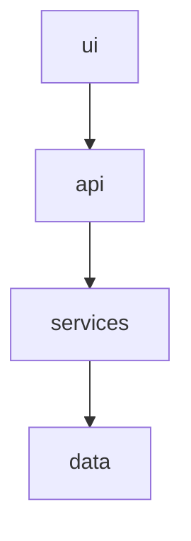

# Modules

> **Audience:** Engineers
> **TL;DR:** _3 lines max — what this document tells the reader._
> **Last verified:** YYYY-MM-DD · commit `abc1234` · Owner: @name

## `<module-name>` — `src/<path>/`
- **Responsibility:** one sentence.
- **Public interface:** exported functions/classes/routes.
- **Depends on:** …   **Used by:** …
- **Data touched:** tables/collections, PII?
- **Security notes:** auth checks, inputs, external calls.
- **Tests:** location, coverage.
- **Known debt / risks:**

_(repeat per module)_
