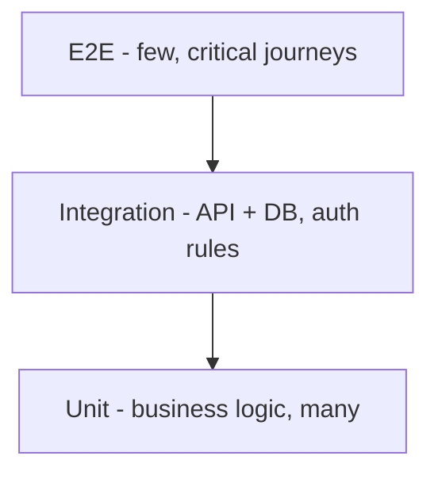

# Testing

> **Audience:** Engineers, QA
> **TL;DR:** _3 lines max — what this document tells the reader._
> **Last verified:** YYYY-MM-DD · commit `abc1234` · Owner: @name

## Strategy

| Layer | Tool | Location | Run command | Coverage |
|---|---|---|---|---|

## Security tests (must exist)
- [ ] Unauthenticated request → 401 on every protected route
- [ ] User A cannot read/update/delete user B's resources (IDOR) → 403/404
- [ ] Non-admin cannot call admin routes → 403
- [ ] Validation rejects oversized/malformed input → 400
- [ ] Rate limit triggers on login/OTP → 429
- [ ] Webhook with bad signature → 400/401

## Missing critical tests
| Area | Risk if untested | Priority |
|---|---|---|

## CI
Where tests run, required checks, flaky-test policy.
