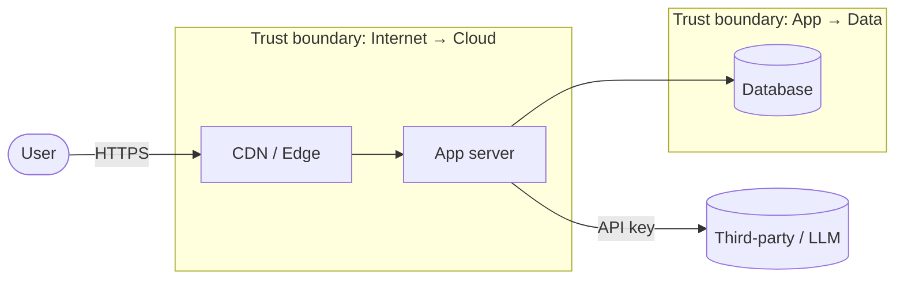

# Threat Model

> **Audience:** Engineers, security, product
> **TL;DR:** _3 lines max — what this document tells the reader._
> **Last verified:** YYYY-MM-DD · commit `abc1234` · Owner: @name

Method: Threat Modeling Manifesto 4 questions · STRIDE · LINDDUN

## 1. What are we working on?

**Assets:** user PII · credentials · payment tokens · business data · availability · reputation

## 2. What can go wrong? — STRIDE
| ID | Element | STRIDE | Threat | Likelihood (1-5) | Impact (1-5) | Risk |
|---|---|---|---|---|---|---|

### Privacy — LINDDUN
| ID | Data flow | Category | Threat | Risk |
|---|---|---|---|---|

### Abuse cases
- As an attacker I want to … so that …

## 3. What are we going to do about it?
| Threat ID | Existing control (file) | Gap | Mitigation | Decision | Owner | Ticket |
|---|---|---|---|---|---|---|

## 4. Did we do a good job?
Assumptions · out of scope · next review trigger (new integration, new data type, new role, major release).
